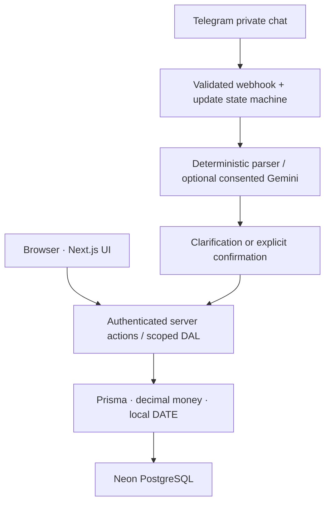

# DuitFlow

Catat belanja melalui chat, pantau bajet melalui dashboard.

A personal finance MVP for Malaysia, built incrementally from
[the specification](DUITFLOW_CODEX_SPEC.md). UI language is Bahasa Melayu,
currency is MYR, and financial dates use Asia/Kuala_Lumpur.

**Status: Phase 2 finance MVP implemented.** Categories, transaction CRUD,
server-side monthly aggregates and budgets are available through the protected web app.
Authentication and Neon configuration are preserved. Phase 3 has not started.
[Phase 1 GitHub CI](https://github.com/shahrilyusoff11/duitflow/actions/runs/43630396318)
passed; Phase 2 local verification is recorded in [STATUS.md](docs/STATUS.md).
The app retains Better Auth GitHub-only OAuth, database sessions,
atomic per-user category seeding, scoped data access, migrations and CI.
Telegram and AI remain later phases. The existing Neon Free production branch is connected and all three
migrations are applied. [Neon setup, complete change record and proof](docs/NEON_SETUP.md).

See [current evidence and acceptance checklist](docs/STATUS.md),
[approved auth approach](docs/AUTH_PROPOSAL.md),
[step-by-step setup](docs/SETUP.md), and
[technical decisions](docs/DECISIONS.md).

## Run locally without provider credentials

Use Node 24 LTS and npm. Node 26 also works locally.

```sh
npm ci
npm run dev
```

Open http://localhost:3000. The landing page does not contact a database or
external service. Builds and automated tests need no real provider credentials.

```sh
npm run lint
npm run typecheck
npm test
npm run build
npx playwright install chromium
npm run test:e2e
```

Playwright starts the production build on 127.0.0.1:3100 with a disposable,
test-only PostgreSQL-compatible socket server and signed persisted session
fixtures. It runs Prisma Migrate and checks desktop/mobile OAuth initiation,
protected access, profile scoping, sign-out, cookie replay, landing navigation,
and category/transaction/budget CRUD with dashboard updates and warnings.
The external GitHub screen is intercepted, never called live. Integration tests
also verify the callback with mocked GitHub HTTP responses. This is separate
from the required real provider verification.

The migration integration suite runs the reviewed SQL in ephemeral, in-memory
PGlite (PostgreSQL WASM), with synthetic data. PGlite is test-only; the deployed
application always uses PostgreSQL through Prisma. Tests never call live AI,
Telegram, GitHub OAuth, or Neon.

## Approved authentication and required live setup

The owner approved **Better Auth + GitHub OAuth only + database sessions** on
15 November 2026. [Approved scope](docs/AUTH_PROPOSAL.md).

Follow [SETUP.md](docs/SETUP.md)'s GitHub section to create the OAuth App, add
GITHUB_CLIENT_ID/GITHUB_CLIENT_SECRET locally, and verify real sign-in/out.
Those steps, Neon migrations, and real sign-in/out verification are now complete
in this workspace. The instructions remain useful for a new environment.
No fake session, test endpoint, password login or account-linking endpoint exists
in the application. Test launchers and fixtures live outside src.
The repository is pushed to GitHub and its first CI run passed every check.

```sh
npm run setup:init
# Add GitHub and database credentials to ignored .env, then:
npm run setup:check
npm run db:deploy
npm run db:status
npm run dev
```

## Database setup (new checkout / another environment)

This workspace is already linked to the owner's production branch. Use
`neon deploy` to reconcile the existing neon.ts and pull its variables. Do not
replace the policy or repeat provider creation. To check this real database:

```sh
npm run db:status
npm run verify:neon
# After npm run build and npm start:
npm run verify:app
```

verify:neon performs only synthetic writes inside a transaction that is always
rolled back. verify:app checks the running app through its real database health
route. These live checks are separate from the disposable automated test suite.

1. Use an existing PostgreSQL database or create a **Neon Free** project. Do not
   enable billing, add a card, or accept an upgrade. Stop if payment is required.
2. Copy `.env.example` to ignored `.env`. Never put secrets into this README,
   a tracked file, a screenshot, or a chat message.
3. Set `DATABASE_URL` to the pooled PostgreSQL URL (Neon hostname with
   `-pooler`) and `DATABASE_URL_UNPOOLED` to the direct URL. `DIRECT_URL` remains
   a conventional fallback alias. Keep TLS enabled.
4. Review all three migration SQL files before applying them to an empty
   development database. The third adds auth and atomic category seeding.
5. Run:

```sh
npm run db:validate
npm run db:generate
npm run db:deploy
npm run db:status
```

The current stable Prisma 7.10.1 uses `prisma7.config.ts`. CLI migrations read
`DATABASE_URL_UNPOOLED` first (then `DIRECT_URL`) from `.env`; the runtime pg
adapter uses pooled `DATABASE_URL`. There is
no fallback to a shared, public or fake database. A missing URL fails when a
database operation is attempted; no DB connection is made during a static build.
The connection pool is small and initialization is reused per Node instance.

For future schema changes use
`npm run db:migrate -- --name descriptive_name` on a disposable development DB.
This drafts a migration with `--create-only`; review the SQL before applying
`npm run db:deploy`. Prisma's dev migration workflow may need a shadow DB.
Never accept a reset on a database with real records. Do not use `db push` to
bypass reviewed migrations.

The second migration contains raw CHECK constraints and a partial unique index
that Prisma cannot fully express. Preserve them when drafting future migrations.
Categories are per user. Composite foreign keys additionally enforce category
ownership and transaction type. These are defense in depth, not a replacement
for authenticated data-access checks. The third migration's User INSERT trigger
seeds defaults inside the signup transaction. It requires an empty pre-auth User
table or an explicit identity migration; no names/emails are invented.

## Structure

```text
src/app/                    Landing, auth, protected finance pages/actions, APIs
src/components/auth/        Sign-in/out controls with loading/error feedback
src/components/finance/     Accessible forms, budget progress, server-rendered chart
src/lib/auth/               Better Auth, session guards, scoped profile DAL
src/lib/config/             Validated, redacted database configuration
src/lib/db/                 Lazy server-only Prisma/pg connection
src/lib/finance/             Scoped DAL, money/date validation, defaults, aggregates
prisma/schema.prisma        Domain + required OAuth identity/session/state models
prisma/migrations/          Domain, integrity, auth and category signup trigger
scripts/                    Safe env initialization and configuration format check
tests/unit/                 Config, money parsing/math, Malaysian calendar tests
tests/integration/          SQL migrations, real sessions, authorization, finance CRUD
tests/e2e/                  Production browser auth and finance flows
docs/                       Decisions, proposal, current status
.github/workflows/ci.yml     Checks + disposable PostgreSQL migration + browser tests
```

## Architecture

The following is the planned Core architecture. Authentication and web finance
are implemented; Telegram, its webhook and parsing remain later phases.



All user-owned DAL operations must require the authenticated `userId`.
Each server page, action, handler and DAL entry checks the real session.
Proxy/layout checks alone are insufficient. Monetary values stay as
DECIMAL(12,2), with decimal arithmetic on the server and string serialization.
`occurredOn` is a Malaysian local calendar DATE. UTC audit timestamps use
TIMESTAMPTZ. No balances are fabricated and AI never writes SQL or saves records.

## Using the finance app (Phase 2)

- **Dashboard**: choose a month for income, expenses, recorded net income minus
  expenses, category breakdown, five recent transactions, budget status and a
  six-month trend. Every total comes from scoped database aggregates on the server.
- **Transaksi**: add income/expenses, open a record to edit or delete it, filter
  by inclusive date range, category, type or description. Lists show 20 records
  per page; DAL callers cannot request more than 50.
- **Kategori**: create, rename, change type or delete personal categories.
  Deleting or changing the type of an in-use category is blocked by PostgreSQL;
  reassign/remove its transactions and budgets first.
- **Bajet**: create, edit or delete a monthly expense-category budget. Warnings
  default to 80% (configurable 1–99%), with a fixed warning at 100%. Remaining
  amounts can be negative when overspent. Only recorded expenses count as spent.

Money input accepts `RM12`, `RM 12`, `rm12.50`, `RM1,200.50`, `12 ringgit`,
`12 ringgit 50 sen`, `1.2k`, `2k` and `50 sen`. Zero, negatives, ambiguous
`1.200`, excess precision and values above RM10,000,000 are rejected.
Dates accept real calendar days from 2000 through 2100; the default day is
resolved in Asia/Kuala_Lumpur on the server. Monthly ranges use an exclusive
next-month boundary. No shared finance cache, schema change, new service or
provider credential is needed for Phase 2. Demo writes are blocked.

## CI and verification

The workflow has passed on GitHub Actions for the Phase 1 commit.
It uses Node 24, an ephemeral PostgreSQL 17 service, reviewed
`prisma migrate deploy`, lint, typecheck, Vitest, build and Chromium smoke tests.
No production credentials are needed. The repository is hosted at https://github.com/shahrilyusoff11/duitflow.
No frontend deployment has been created. Local evidence and limitations are in
[STATUS.md](docs/STATUS.md).

## Free-tier deployment plan (not performed)

- Use Vercel Hobby for a small, personal, non-commercial portfolio and a free
  `*.vercel.app` URL. Owner approval and manual project setup are still required.
- Use Neon Free with separate pooled/runtime and direct/migration URLs.
- Verify provider terms, quotas and region/privacy implications again during
  deployment. Free tiers are not unlimited and terms change.
- Configure approved OAuth credentials and exact production callback URL.
- Later, create a bot with BotFather and configure an HTTPS webhook with a secret
  and `allowed_updates: ["message", "callback_query"]`. Do not configure a
  webhook before its secure handler and tests exist.
- Gemini is optional, default off per user, and must have a currently eligible
  free API model. No model/key is chosen or needed in Phase 1.
- No paid billing, card, custom domain, paid API, analytics, or automatic resource
  provisioning has been enabled.

Neon may autosuspend, so initial requests after inactivity can be slower.
Free-tier recovery/history/export limits must be checked at setup; there is
currently no backup automation or CSV export. Do not use the app as the sole copy
of important financial records. Lazy bounded cleanup of expired Telegram actions,
old updates and rate-limit events belongs to the later bot implementation; no
cron job or cleanup behavior is claimed today.

## Privacy and credential rotation

Only synthetic records are used in tests. No live financial records, provider
credentials, or raw chat messages are committed or logged. AI parsing will be
explicitly opt-in, with a provider data-use notice and minimal prompt payload.
A future demo account must be read-only or safely reset and must block Telegram
linking and AI. No demo credentials are provided; finance mutations reject demo users.

If credentials leak: revoke the Telegram bot token through BotFather
`/revoke`, replace the webhook secret with a new random secret, revoke/replace
the Gemini key in the provider console, update local/hosting environment values,
redeploy, and re-run Telegram `setWebhook` with the new token/secret. Also rotate
any exposed database password, OAuth client secret and auth secret, revoking
active sessions as appropriate. Never commit the replacement values.

This is an unfinished portfolio MVP, not reviewed for real financial data.
If anyone besides the owner uses it, assess Malaysia's PDPA (Personal Data
Protection Act 2010) obligations and obtain a proper security/privacy review.
It offers no banking connection, financial advice, payment or transfer capability.
# duitflow
