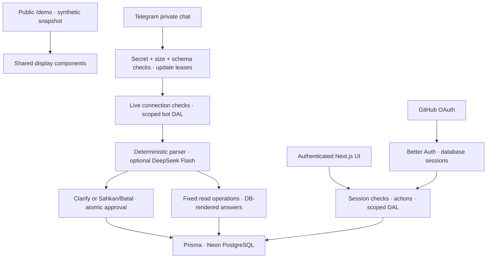

# DuitFlow

**Catat belanja melalui chat, pantau bajet melalui dashboard.**

A personal finance portfolio app for Malaysia: income/expense tracking, monthly
budgets, a Telegram bot with explicit approval, and an optional AI parser. The
UI uses Bahasa Melayu, MYR and Malaysian calendar dates.

**Live on Vercel Hobby:** [DuitFlow](https://duitflow-lyart.vercel.app) ·
[read-only demo](https://duitflow-lyart.vercel.app/demo).
**Phase 5 is complete.** Local/CI checks and hosted browser-to-Neon readiness
pass. The owner confirmed real GitHub sign-in/out/re-login, synthetic web CRUD,
Telegram linking and one confirmed bot expense with no duplicate on re-tap.
Bot: [@duitflow00bot](https://t.me/duitflow00bot). DeepSeek Flash is available
in Production for Telegram users who opt in from Settings. Recurring bills are
available in this checkout and await a production release.

- [Implementation evidence and acceptance status](docs/STATUS.md)
- [Actual Vercel setup and release record](docs/VERCEL_SETUP.md)
- [Deployment plan and approval checklist](docs/DEPLOYMENT.md)
- [Specification](DUITFLOW_CODEX_SPEC.md) and [technical decisions](docs/DECISIONS.md)

## Explore the read-only demo

Open [the live demo](https://duitflow-lyart.vercel.app/demo), or run the app and
open [the local demo](http://localhost:3000/demo). It displays
clearly labeled synthetic transactions and budgets without a database or
provider credentials. It has no session, account, write access, Telegram linking
or AI dispatch, and never reads anyone's financial records. Sign in separately
through GitHub to use the real application. The owner confirmed the production
callback and real sign-in; demo data remains separate from their account.


<details>
<summary>Mobile screenshot</summary>


</details>

The screenshots show the local frontend redesign using synthetic data. The
six-month chart includes an expandable table of exact MYR values. On the
signed-in dashboard, **Tambah transaksi** opens the entry form directly.
Select a recent transaction to view its details. The monthly budget appears
below the ledger, followed by expandable categories and account information.
On **Transaksi**, choosing **Perbelanjaan** or **Pendapatan** narrows the
category list when adding, editing or filtering records.

## Run locally

Use Node 24 LTS and npm. Node 26 is also supported for local development.

```sh
npm ci
npm run dev
```

Open [localhost:3000](http://localhost:3000). The landing page and `/demo` work
without credentials; builds and automated tests need no real provider keys.
For authenticated finance, follow [the setup guide](docs/SETUP.md):

```sh
npm run setup:init
# Save approved database/GitHub OAuth configuration in ignored .env.
npm run setup:check
npm run db:validate
npm run db:deploy
npm run db:status
npm run dev
```

`setup:check` validates formats without printing secrets; it does not verify
provider credentials or connectivity. Never paste credentials into chat or Git.
This workspace's Neon Free database and real local GitHub OAuth were configured
and verified in Phase 1; preserve them. A new environment needs its own approved
configuration. Authentication is **Better Auth, GitHub OAuth only, and database
sessions**: see [the auth decision](docs/AUTH_PROPOSAL.md) and
[Neon evidence](docs/NEON_SETUP.md).

## Features

| Area | Behavior |
| --- | --- |
| Authentication | Real GitHub sign-in/out; signed database sessions; independent page/action/API/DAL checks |
| Transactions | Income/expense CRUD, date/category/type/description filters and bounded pagination |
| Categories | Personal defaults, atomic signup seeding, owner/type constraints and in-use deletion protection |
| Dashboard | Server-computed monthly totals, category breakdown, recent records and six-month trend |
| Budgets | Monthly category limits, exact spent/remaining amounts and configurable warnings |
| Recurring bills | Monthly or yearly bills, a 30-day forecast, and prefilled expense confirmation |
| Telegram | Single-use linking, private-chat commands, clarification, Sahkan/Batal and replay-safe writes |
| Optional AI | Consent off by default; bounded extraction, fixed scoped queries, Postgres caps and deterministic fallback |
| Public demo | Immutable synthetic snapshot isolated from real accounts and provider calls |

Recorded net means income minus recorded expenses for the selected period.
Open **Bil akan datang → Urus bil** to plan recurring bills. **Rekod bayaran**
prefills the bill's name, amount, and today's payment date. Confirming records
the actual expense and moves the bill's next due date forward. Planned bills
stay out of spending totals until a payment is confirmed.

Money accepts `RM12`, `RM1,200.50`, `12 ringgit 50 sen`, `1.2k` and `50 sen`.
Zero, negatives, ambiguous precision and amounts above RM10,000,000 are rejected.
Money stays Decimal on the server and strings on the client. `occurredOn` is a
Malaysian local DATE; month ranges exclude the next month's first day. Audit
timestamps use UTC.

## Architecture



Every user-owned DAL entry requires `userId` and independently verifies its
identity boundary. Web requests verify real sessions; bot operations recheck the
persisted private-chat connection under a user lock. Layout protection alone is
insufficient. Authenticated finance results have no shared cache. AI cannot
authorize writes, choose identities, generate SQL or invent financial totals.

```text
src/app/                 Landing, demo, auth, finance, Settings and API routes
src/components/          Accessible auth, finance and Telegram UI
src/lib/auth/            Better Auth, sessions and scoped profile access
src/lib/finance/         Scoped DAL, Decimal money, dates and aggregates
src/lib/telegram/        Parser, transport, connection DAL and retry state
src/lib/ai/              Optional adapter, validation, consent and fixed answers
src/lib/demo/            Synthetic public demo data only
prisma/migrations/       Reviewed, append-only SQL migrations
scripts/                Setup and verification utilities
tests/                  Unit, disposable DB integration, browser and golden cases
docs/                   Setup, approval plans, evidence and screenshots
```

## Configuration and database workflow

Use [.env.example](.env.example). Values belong in ignored `.env` or separately
approved hosting secret storage. Only `NEXT_PUBLIC_APP_URL` is intended to be
public; keep keys and connection strings server-side.

| Variables | Purpose |
| --- | --- |
| `DATABASE_URL` | Pooled runtime PostgreSQL URL, with TLS |
| `DATABASE_URL_UNPOOLED` or `DIRECT_URL` | Direct migration URL; first name takes precedence |
| `BETTER_AUTH_SECRET`, `BETTER_AUTH_URL` | Strong secret and exact app origin |
| `GITHUB_CLIENT_ID`, `GITHUB_CLIENT_SECRET` | Approved GitHub OAuth app |
| `TELEGRAM_BOT_TOKEN`, `TELEGRAM_WEBHOOK_SECRET`, `TELEGRAM_BOT_USERNAME` | Optional bot; configure all three after approval |
| `AI_PROVIDER` | Defaults to `deterministic`. DeepSeek settings are in [AI_SETUP.md](docs/AI_SETUP.md) |
| `NEXT_PUBLIC_APP_URL`, `APP_TIMEZONE`, `APP_CURRENCY` | App URL, `Asia/Kuala_Lumpur`, `MYR` |

Prisma 7.10 uses `prisma7.config.ts`. The app uses pooled `DATABASE_URL`;
migrations prefer `DATABASE_URL_UNPOOLED`, falling back to `DIRECT_URL`.
Builds do not connect to a database. There is no public/shared database fallback.
Keep the existing `neon.ts` and agent configuration.

```sh
npm run db:generate
npm run db:validate
# Future changes: disposable development DB, never reset real records.
npm run db:migrate -- --name descriptive_name
# Review SQL, then apply reviewed migrations to the intended DB.
npm run db:deploy
npm run db:status
```

Preserve SQL money/period checks, category owner/type keys, the pending-action
partial index and User INSERT seed trigger. Drafting migrations may need a
shadow DB. Never accept a reset of real data or bypass migrations with `db push`.
Live checks are separate from automated tests and need their authorization:

```sh
npm run db:preflight
npm run verify:neon
# After npm run build and npm start:
npm run verify:app
```

`verify:neon` rolls back all synthetic writes. `verify:app` checks readiness and
anonymous denial; it does not perform real OAuth consent or bot delivery.

## Telegram and optional AI

Follow [Telegram setup](docs/TELEGRAM_SETUP.md) after provider setup is approved.
Settings generates a ten-minute link. Open it in Telegram and enter the bot's
code in signed-in Settings to activate the connection. Unlinking invalidates
pending links and proposals. Only linked private-chat users can query records.

Commands: `/start`, `/help`, `/link`, `/balance`, `/budget`, `/report`, `/cancel`.
Financial commands also accept `YYYY-MM`. Try synthetic messages such as
`Makan RM12`, `Gaji RM2500`, or `kopi RM8 lepas tu minyak RM40`. Missing details
prompt clarification. Only **Sahkan** saves; a casual `ya` never writes.

Secret checks precede parsing. DONE updates deduplicate; failed/stale leases
retry; active leases return retryable 503 without duplicate work. Stable action
IDs and atomic approval prevent duplicate transactions. Telegram calls have
four-second deadlines; optional AI has five seconds; the route declares 30
seconds. Processing finishes before HTTP success; `after()` only cleans up.
Replies may be uncertain or repeat after a network timeout while writes remain
idempotent.

DeepSeek consent defaults off, including for users with the legacy preference
enabled. The owner approved metered Flash usage on the existing API account.
See the [AI setup guide](docs/AI_SETUP.md).

The local parser runs first. Supported financial questions stay on the server.
Optional AI suggests categories using app-owned keywords and generic labels.
The AI caps are 2/minute and 30/24 hours per user, plus 4/minute and 30/24 hours
across the app. Missing configuration, opt-out, cap, invalid output or timeout
uses local handling. See the [mocked golden set](docs/AI_GOLDEN_REPORT.md).

## Checks and evidence

```sh
npm run lint
npm run typecheck
npm test
npm run build
npx playwright install chromium
npm run test:e2e
```

Integration tests use synthetic data and disposable PGlite through real
Prisma/pg. Browser tests run the production build with persisted signed test
sessions and explicitly override all three DB URL aliases and AI configuration.
Provider HTTP is mocked; CI makes no live AI calls. The app contains no test
login endpoint or session bypass.

[Release CI run 43702137694](https://github.com/shahrilyusoff11/duitflow/actions/runs/43702137694)
passed on deployed source `9bd3995bc28f21530a440ea7f59d34048343598a`: install,
schema validation, disposable PostgreSQL migrations, lint, typecheck,
**316 tests**, production build and **28 browser tests**. CI uses Node 24;
the Vercel release uses Node 26.x. [STATUS.md](docs/STATUS.md) records the initial
CI fixture failure, repair, local checks and hosted evidence separately.

## Deployment, privacy and limits

The approved manual CLI release is live on Vercel Hobby. The public landing,
demo and sign-in return 200; anonymous profile access returns 401 and dashboard
access redirects to sign-in. The hosted headless `verify:app` check passed
browser → readiness handler → Prisma → existing Neon, with zero client errors.
Generated deployment URLs remain protected; no Git auto-deploy integration is
configured. An earlier five-minute runtime-log window contained a `pg` SSL-mode
future-deprecation warning on a healthy readiness request, with no observed
request failures. After the owner smoke, hosted readiness passed again with
zero browser errors; the final deployment's recent five-minute request-log
window had zero HTTP ≥500 requests, and a targeted check of 14 public HTML/JS
files found no configured app credential values. These bounded results are not
an uptime guarantee, exhaustive audit or claim of zero runtime log entries.

The [deployment runbook](docs/DEPLOYMENT.md) covers env scopes, secure webhook
registration, live synthetic acceptance and rollback. Production webhook
authentication probes passed (missing secret 401, correct secret/empty update
200), and Telegram confirmed its canonical URL and update filters. The owner
separately confirmed actual production OAuth, web CRUD, private Telegram linking,
Sahkan saving exactly one expense and re-tap creating no duplicate. This owner
report is distinct from headless readiness/CI evidence. Live unlink was not part
of that smoke check; its existing automated tests pass. See
[the setup record](docs/VERCEL_SETUP.md).

Hosting and database target RM0/month on Vercel Hobby and Neon Free for this
personal, non-commercial portfolio. Optional DeepSeek Flash inference is metered
separately. Neon autosuspend and hosting cold starts
can delay requests. Free capacity/history/recovery are limited; there is no
backup automation or CSV export. Do not keep the only copy of important records
here. Telegram cleanup is lazy and bounded; no cron, Redis or separate backend.

Use synthetic portfolio data. Bot messages pass through Telegram. With AI consent
and activation, DeepSeek receives selected bookkeeping keywords, direction and
generic category labels. Amounts, dates, descriptions and custom labels stay in
DuitFlow. No credentials, linking URLs, cookies or
real financial messages belong in logs, tests, screenshots or Git. Before wider
use, obtain a security/privacy review and assess Malaysian PDPA obligations.
This app has no bank connections, payments, transfers or financial advice.

For leaks, revoke credentials at the provider, replace only in approved stores,
and restart/redeploy. Use BotFather `/revoke`; rotate the webhook secret and
repeat `setWebhook`. Revoke exposed DeepSeek, database or OAuth credentials.
Auth-secret rotation invalidates session signatures and affects encrypted
provider tokens; plan re-authentication. See [rotation and rollback](docs/DEPLOYMENT.md).
