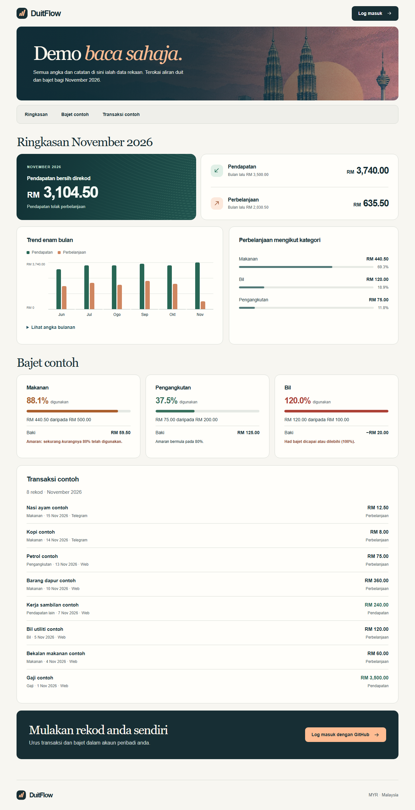
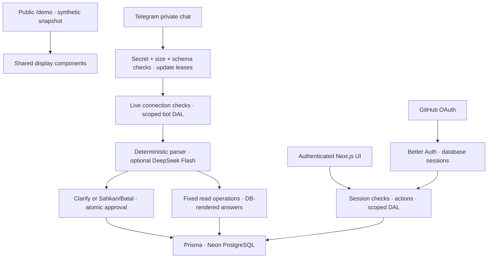

# DuitFlow

**Catat belanja melalui chat, pantau bajet melalui dashboard.**

A personal finance portfolio app for Malaysia: income/expense tracking, monthly
budgets, a Telegram bot with explicit approval, and an optional AI parser. The
UI uses Bahasa Melayu, MYR and Malaysian calendar dates.

**Live on Vercel Hobby:** [DuitFlow](https://duitflow-lyart.vercel.app) ·
[read-only demo](https://duitflow-lyart.vercel.app/demo).
**Phase 5 is complete.** Local/CI checks and hosted browser-to-Neon readiness
pass. The owner confirmed real GitHub sign-in/out/re-login, synthetic web CRUD,
Telegram linking and one confirmed bot expense with no duplicate on re-tap.
Bot: [@duitflow00bot](https://t.me/duitflow00bot). DeepSeek Flash is available
in Production for Telegram users who opt in from Settings. The 19 November
release includes the expanded bill schedules and Telegram finance tools.

- [Implementation evidence and acceptance status](docs/STATUS.md)
- [Actual Vercel setup and release record](docs/VERCEL_SETUP.md)
- [Deployment plan and approval checklist](docs/DEPLOYMENT.md)
- [Specification](DUITFLOW_CODEX_SPEC.md) and [technical decisions](docs/DECISIONS.md)

## Explore the read-only demo

Open [the live demo](https://duitflow-lyart.vercel.app/demo), or run the app and
open [the local demo](http://localhost:3000/demo). It displays
clearly labeled synthetic transactions and budgets without a database or
provider credentials. It has no session, account, write access, Telegram linking
or AI dispatch, and never reads anyone's financial records. Sign in separately
through GitHub to use the real application. The owner confirmed the production
callback and real sign-in; demo data remains separate from their account.



<details>
<summary>Mobile screenshot</summary>


</details>

The screenshots show the local frontend redesign using synthetic data. The
six-month chart includes an expandable table of exact MYR values. On the
signed-in dashboard, **Tambah transaksi** opens the entry form directly.
Select a recent transaction to view its details. The monthly budget appears
below the ledger, followed by expandable categories and account information.
On **Transaksi**, choosing **Perbelanjaan** or **Pendapatan** narrows the
category list when adding, editing or filtering records.

## Run locally

Use Node 24 LTS and npm. Node 26 is also supported for local development.

```sh
npm ci
npm run dev
```

Open [localhost:3000](http://localhost:3000). The landing page and `/demo` work
without credentials; builds and automated tests need no real provider keys.
For authenticated finance, follow [the setup guide](docs/SETUP.md):

```sh
npm run setup:init
# Save approved database/GitHub OAuth configuration in ignored .env.
npm run setup:check
npm run db:validate
npm run db:deploy
npm run db:status
npm run dev
```

`setup:check` validates formats without printing secrets; it does not verify
provider credentials or connectivity. Never paste credentials into chat or Git.
This workspace's Neon Free database and real local GitHub OAuth were configured
and verified in Phase 1; preserve them. A new environment needs its own approved
configuration. Authentication is **Better Auth, GitHub OAuth only, and database
sessions**: see [the auth decision](docs/AUTH_PROPOSAL.md) and
[Neon evidence](docs/NEON_SETUP.md).

## Features

| Area | Behavior |
| --- | --- |
| Authentication | Real GitHub sign-in/out; signed database sessions; independent page/action/API/DAL checks |
| Transactions | Income/expense CRUD, date/category/type/description filters and bounded pagination |
| Categories | Personal defaults, atomic signup seeding, owner/type constraints and in-use deletion protection |
| Dashboard | Server-computed monthly totals, category breakdown, recent records and six-month trend |
| Budgets | Monthly category limits, exact spent/remaining amounts and configurable warnings |
| Bills | Monthly, yearly, one-off and installment schedules, a 30-day forecast, and atomic expense recording |
| Telegram | Private-chat linking, confirmed transaction edits and undo, budget limits, recent-record references, spending comparisons, reminders and weekly summaries |
| Optional AI | Consent off by default; bounded extraction, fixed scoped queries, Postgres caps and deterministic fallback |
| Public demo | Immutable synthetic snapshot isolated from real accounts and provider calls |

Recorded net means income minus recorded expenses for the selected period.
Open the **Bil** tab to see overdue, scheduled, paused and completed bills. The dashboard
shows a 30-day forecast with a link to the bill list. **Rekod bayaran**
prefills the bill's name, amount, and today's payment date. Confirming records
the actual expense and advances or completes the schedule. Planned bills
stay out of spending totals until a payment is confirmed.

Money accepts `RM12`, `RM1,200.50`, `12 ringgit 50 sen`, `1.2k` and `50 sen`.
Zero, negatives, ambiguous precision and amounts above RM10,000,000 are rejected.
Money stays Decimal on the server and strings on the client. `occurredOn` is a
Malaysian local DATE; month ranges exclude the next month's first day. Audit
timestamps use UTC.

## Architecture



Every user-owned DAL entry requires `userId` and independently verifies its
identity boundary. Web requests verify real sessions; bot operations recheck the
persisted private-chat connection under a user lock. Layout protection alone is
insufficient. Authenticated finance results have no shared cache. AI cannot
authorize writes, choose identities, generate SQL or invent financial totals.

```text
src/app/                 Landing, demo, auth, finance, Settings and API routes
src/components/          Accessible auth, finance and Telegram UI
src/lib/auth/            Better Auth, sessions and scoped profile access
src/lib/finance/         Scoped DAL, Decimal money, dates and aggregates
src/lib/telegram/        Parser, transport, connection DAL and retry state
src/lib/ai/              Optional adapter, validation, consent and fixed answers
src/lib/demo/            Synthetic public demo data only
prisma/migrations/       Reviewed, append-only SQL migrations
scripts/                Setup and verification utilities
tests/                  Unit, disposable DB integration, browser and golden cases
docs/                   Setup, approval plans, evidence and screenshots
```

## Configuration and database workflow

Use [.env.example](.env.example). Values belong in ignored `.env` or separately
approved hosting secret storage. Only `NEXT_PUBLIC_APP_URL` is intended to be
public; keep keys and connection strings server-side.

| Variables | Purpose |
| --- | --- |
| `DATABASE_URL` | Pooled runtime PostgreSQL URL, with TLS |
| `DATABASE_URL_UNPOOLED` or `DIRECT_URL` | Direct migration URL; first name takes precedence |
| `BETTER_AUTH_SECRET`, `BETTER_AUTH_URL` | Strong secret and exact app origin |
| `GITHUB_CLIENT_ID`, `GITHUB_CLIENT_SECRET` | Approved GitHub OAuth app |
| `TELEGRAM_BOT_TOKEN`, `TELEGRAM_WEBHOOK_SECRET`, `TELEGRAM_BOT_USERNAME` | Optional bot; configure all three after approval |
| `CRON_SECRET` | Separate server-only secret of at least 32 characters for Telegram notification checks |
| `AI_PROVIDER` | Defaults to `deterministic`. DeepSeek settings are in [AI_SETUP.md](docs/AI_SETUP.md) |
| `NEXT_PUBLIC_APP_URL`, `APP_TIMEZONE`, `APP_CURRENCY` | App URL, `Asia/Kuala_Lumpur`, `MYR` |

Prisma 7.10 uses `prisma7.config.ts`. The app uses pooled `DATABASE_URL`;
migrations prefer `DATABASE_URL_UNPOOLED`, falling back to `DIRECT_URL`.
Builds do not connect to a database. There is no public/shared database fallback.
Keep the existing `neon.ts` and agent configuration.

```sh
npm run db:generate
npm run db:validate
# Future changes: disposable development DB, never reset real records.
npm run db:migrate -- --name descriptive_name
# Review SQL, then apply reviewed migrations to the intended DB.
npm run db:deploy
npm run db:status
```

Preserve SQL money/period checks, category owner/type keys, the pending-action
partial index and User INSERT seed trigger. Drafting migrations may need a
shadow DB. Never accept a reset of real data or bypass migrations with `db push`.
Live checks are separate from automated tests and need their authorization:

```sh
npm run db:preflight
npm run verify:neon
# After npm run build and npm start:
npm run verify:app
```

`verify:neon` rolls back all synthetic writes. `verify:app` checks readiness and
anonymous denial; it does not perform real OAuth consent or bot delivery.

## Telegram and optional AI

Follow [Telegram setup](docs/TELEGRAM_SETUP.md) after provider setup is approved.
Settings generates a ten-minute link. Open it in Telegram and enter the bot's
code in signed-in Settings to activate the connection. Unlinking invalidates
pending links and proposals. Only linked private-chat users can query records.

You can chat in casual Malay and English:

- `Hari ini saya isi minyak RM60 dan bayar tol RM8` proposes two expenses in
  one confirmation.
- `Aku dapat duit poket daripada abang` asks for the missing amount.
- `Berapa aku spend bulan ni?` reads the total from your recorded expenses.
- `Bagi report perbelanjaan aku bulan ni` shows the total and category breakdown.
- With DeepSeek enabled, `Duit aku bocor kat mana bulan ni?` and
  `Kategori apa paling banyak aku spend?` both show ranked spending categories.
  Follow with `Kalau bulan lepas?` to see the same answer for the previous month.
- `Tukar tol tadi kepada RM10` finds matching transactions dated today in
  Malaysia and previews the old and new amounts. Reply `yang kedua` if the bot
  lists several matches. `Undo catatan terakhir` previews removal of the most
  recently recorded transaction across web and Telegram.
- `Bajet makan bulan depan RM400` previews a new limit or shows the old and new
  limits for that category and Malaysian month.
- `Kenapa belanja aku naik?` compares the same number of elapsed calendar days
  this month and last month. It shows contributing categories, sample ledger
  entries, and a separate suggestion for reviewing spending.
- `Analisis kewangan aku bulan ni` summarizes recorded income, spending,
  budget warnings and how spending changed against the same days last month.
  Follow with `Kalau bulan lepas?` or `Ada cadangan?`.
- `Trend belanja tiga bulan` shows monthly spending. `Boleh spend RM100 untuk
  makan?` checks the effect on the selected category's budget. Follow with
  `Kalau RM50 pula?` to try a different amount.
- `Ada bil kena bayar tak?` lists overdue bills and bills due within 30 days.
- `Bil terdekat apa?` shows the next active bill due today or later.
- `Bil tiket RM70 sekali bayar 2026-11-20` adds a one-off schedule.
  `Ansuran laptop RM100 6 kali bayar pada 2026-11-30` adds a counted schedule.
  Use `hingga 2027-04-30` in place of the count to set an end date.
  `Ansuran seterusnya` and `Status ansuran laptop` show dates and progress.
  Web and Telegram use the same schedule. Confirming a payment records the
  expense and advances or completes the bill in one database transaction.
- `Dah bayar bil yang tadi` uses the bill just shown in that chat. `Transaksi tu`
  and `yang kedua` work with recent numbered results when the reference is
  unambiguous. The context lasts 10 minutes and `/cancel` clears it. When more
  than one record fits, the bot asks you to choose.

Only **Sahkan** saves a proposal. Commands include `/start`, `/help`, `/link`,
`/balance`, `/budget`, `/report`, `/bills`, `/peringatan`, `/mingguan`
and `/cancel`. Add `YYYY-MM`
after `/balance`, `/budget`, or `/report` to choose a month.

Undo of a tracked bill payment removes the expense and reopens its due date in
the same transaction. It requires the bill version from that payment. Records
from before the payment-tracking migration have no reliable bill association,
so Telegram declines undo for those legacy records.

### Optional Telegram notifications

Preferences default off. Telegram shows the proposed change before saving it.

| Command | Effect |
| --- | --- |
| `/peringatan bil 3` | Remind once per due date, up to 3 days ahead. Set 0–30 days |
| `/peringatan bajet 80` | Remind once per budget per month when spending reaches 80% of the limit. Set 1–100% |
| `/peringatan bil off`, `/peringatan bajet off`, `/peringatan off` | Stop one or both reminders |
| `/mingguan Isnin` | Choose a Malay weekday for one summary per week |
| `/mingguan off` | Stop weekly summaries |

The summary covers the last complete Monday–Sunday week, the highest expense
category, current monthly budget balances and bills due in the next seven days.
Vercel Hobby runs one daily check in the 9:00–9:59 a.m. Malaysia window. A
missed weekly run can catch up later in that same week. PostgreSQL claims each
delivery before sending. An explicit Telegram rate-limit rejection can be
retried on a later invocation while it is still eligible. An uncertain timeout
or interrupted send can leave a message undelivered. Telegram's Bot API has no
deduplication key for `sendMessage`. [Vercel Cron limits](https://vercel.com/docs/schedules/cron-jobs/usage-and-pricing) · [Telegram Bot API](https://core.telegram.org/bots/api#sendmessage)

Secret checks precede parsing. DONE updates deduplicate; failed/stale leases
retry; active leases return retryable 503 without duplicate work. Stable action
IDs and atomic approval prevent duplicate transactions. Telegram calls have
four-second deadlines; optional AI has five seconds; the route declares 30
seconds. Processing finishes before HTTP success; `after()` only cleans up.
Replies may be uncertain or repeat after a network timeout while writes remain
idempotent.

Enable **Tafsiran mesej Telegram oleh DeepSeek** in **Tetapan**. It defaults off
for every account, including prior category-only opt-ins. Clear requests and
commands run locally. DeepSeek Flash can interpret unclear financial questions,
follow-ups, bill lookups, completed bill payments and transaction entries.
It returns a structured function choice. DuitFlow matches records and categories,
resolves dates in Malaysia, calculates amounts with Decimal and previews any
proposed change. The Telegram chat keeps recent monthly topics and record
references for 10 minutes. Use `/cancel` to clear them.

DeepSeek receives the order of recognized Malay and English words from the
current message, placeholders for values and names, and the app's generic
category labels. DuitFlow retains the placeholder values, account identity,
chat context, ledger and query results. Messages with recognized sensitive
patterns use local processing.
The AI caps are 2/minute and 30/24 hours per user, plus 4/minute and 30/24 hours
across the app. Missing configuration, opt-out, cap, invalid output or timeout
uses local handling. See the [AI setup guide](docs/AI_SETUP.md) and
[local verification results](docs/STATUS.md).

## Checks and evidence

```sh
npm run db:validate
npm run lint
npm run typecheck
npm test
npm run build
npx playwright install chromium
npm run test:e2e
```

Integration tests use synthetic data and disposable PGlite through real
Prisma/pg. Browser tests run the production build with persisted signed test
sessions and explicitly override all three DB URL aliases and AI configuration.
Provider HTTP is mocked; CI makes no live AI calls. The app contains no test
login endpoint or session bypass.

The 19 November 2026 local Telegram update passed Prisma validation, lint,
typecheck, **379 unit and integration tests**, the production build and
**36 desktop and mobile Chromium tests**. Prisma applied the reviewed migrations
to a disposable database for the browser suite. [Local test results](docs/STATUS.md#deepseek-telegram-message-interpretation--19-november-2026)

[Release CI run 43702137694](https://github.com/shahrilyusoff11/duitflow/actions/runs/43702137694)
passed on deployed source `9bd3995bc28f21530a440ea7f59d34048343598a`: install,
schema validation, disposable PostgreSQL migrations, lint, typecheck,
**316 tests**, production build and **28 browser tests**. CI uses Node 24;
the Vercel release uses Node 26.x. [STATUS.md](docs/STATUS.md) records the initial
CI fixture failure, repair, local checks and hosted evidence separately.

## Deployment, privacy and limits

The 19 November release is live on Vercel Hobby. The public landing,
demo and sign-in return 200; anonymous profile access returns 401 and dashboard
access redirects to sign-in. The hosted headless `verify:app` check passed
browser → readiness handler → Prisma → existing Neon, with zero client errors.
Generated deployment URLs remain protected. An earlier five-minute
runtime-log window contained a `pg` SSL-mode
future-deprecation warning on a healthy readiness request, with no observed
request failures. After the owner smoke, hosted readiness passed again with
zero browser errors; the final deployment's recent five-minute request-log
window had zero HTTP ≥500 requests, and a targeted check of 14 public HTML/JS
files found no configured app credential values. These bounded results are not
an uptime guarantee, exhaustive audit or claim of zero runtime log entries.

The [deployment runbook](docs/DEPLOYMENT.md) covers env scopes, secure webhook
registration, live synthetic acceptance and rollback. Production webhook
authentication probes passed (missing secret 401, correct secret/empty update
200), and Telegram confirmed its canonical URL and update filters. The owner
separately confirmed actual production OAuth, web CRUD, private Telegram linking,
Sahkan saving exactly one expense and re-tap creating no duplicate. This owner
report is distinct from headless readiness/CI evidence. Live unlink was not part
of that smoke check; its existing automated tests pass. See
[the setup record](docs/VERCEL_SETUP.md).

Hosting and database target RM0/month on Vercel Hobby and Neon Free for this
personal, non-commercial portfolio. Optional DeepSeek Flash inference is metered
separately. Neon autosuspend and hosting cold starts
can delay requests. Free capacity/history/recovery are limited; there is no
backup automation or CSV export. Do not keep the only copy of important records
here. Telegram notifications use Vercel Cron and the existing
PostgreSQL database.

The production database has applied the Telegram and DeepSeek consent
migrations. Vercel registered the daily Telegram notification job and uses a
Production-only `CRON_SECRET`. The first scheduled delivery and the new
signed-in Telegram flows still need live verification. Vercel does not
automatically retry failed cron runs.
[Production release](docs/STATUS.md#production-release--19-november-2026) · [Vercel cron management](https://vercel.com/docs/schedules/cron-jobs/manage-cron-jobs#error-handling)

Use synthetic portfolio data. Bot messages pass through Telegram. See the
[optional AI disclosure](docs/AI_SETUP.md) for the provider payload. No credentials,
linking URLs, cookies or
real financial messages belong in logs, tests, screenshots or Git. Before wider
use, obtain a security/privacy review and assess Malaysian PDPA obligations.
This app has no bank connections, payments, transfers or financial advice.

For leaks, revoke credentials at the provider, replace only in approved stores,
and restart/redeploy. Use BotFather `/revoke`; rotate the webhook secret and
repeat `setWebhook`. Revoke exposed DeepSeek, database or OAuth credentials.
Auth-secret rotation invalidates session signatures and affects encrypted
provider tokens; plan re-authentication. See [rotation and rollback](docs/DEPLOYMENT.md).
